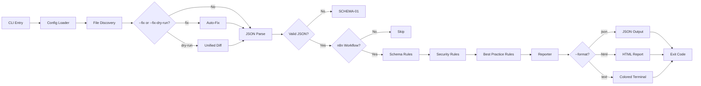

# n8n-lint

[](https://github.com/lorenzespinosa/n8n-lint/actions/workflows/ci.yml)
[](https://opensource.org/licenses/MIT)
[](https://nodejs.org/)
[]()

**Static analysis for n8n workflow JSON files.** Catch credential leaks, deprecated nodes, schema errors, and best-practice violations before they hit production. 16 rules, shareable configs with profiles, three output formats, a GitHub Action, CI-ready.

---

## Quick Start

```bash
npx github:lorenzespinosa/n8n-lint .
```

That's it. Scans all `.json` workflow files in the current directory and prints results.

## Installation

```bash
# Global
npm install -g github:lorenzespinosa/n8n-lint

# Project-local
npm install --save-dev github:lorenzespinosa/n8n-lint

# No install (npx)
npx github:lorenzespinosa/n8n-lint ./workflows/
```

## Usage

```bash
# Lint a single file
n8n-lint workflow.json

# Lint a directory (recursive)
n8n-lint ./workflows/

# Auto-fix safe issues (strip instanceId, set active:false)
n8n-lint --fix ./workflows/

# Preview fixes as a unified diff without writing anything
n8n-lint --fix-dry-run ./workflows/

# Output formats: text (default), json, html
n8n-lint --format text ./workflows/
n8n-lint --format json ./workflows/
n8n-lint --format html ./workflows/ > report.html

# Errors only (quiet mode)
n8n-lint --quiet ./workflows/

# Override one rule without editing the config (repeatable)
n8n-lint --rule BP-05=error ./workflows/

# Print the resolved config (file + profiles + CLI flags) for CI debugging
n8n-lint --print-config

# Custom config path (skips discovery)
n8n-lint --config path/to/.n8nlintrc.json ./workflows/
```

### Sample Output

```
workflows/intake-form.json
  ✗ [SEC-01] Possible Bearer token in node "HTTP Request": "Bearer s...[REDACTED]" (HTTP Request)
  ✗ [SEC-02] meta.instanceId found: "abc123de..." — strip before sharing
    Fix: Remove meta.instanceId from the workflow JSON
  ⚠ [BP-02] Node "My Function" uses deprecated "n8n-nodes-base.function" — use "n8n-nodes-base.code" instead (My Function)
  ⚠ [BP-05] Node "API Call" is an HTTP Request without error handling — add continueOnFail, retryOnFail, or set an error workflow (API Call)

workflows/valid-workflow.json
  ✓

2 files checked · 2 errors · 2 warnings
```

### Try It on the Examples

The [`examples/`](examples/) directory has a clean workflow and an intentionally-flawed one:

```bash
# Passes - exits 0
n8n-lint examples/clean-intake-workflow.json

# Fails - 4 errors, 5 warnings across SEC, BP, and schema rules
n8n-lint examples/flawed-intake-workflow.json

# Same findings as a redirectable HTML report
n8n-lint --format html examples/flawed-intake-workflow.json > report.html
```

## Output Formats

`--format <text|json|html>` selects the reporter. An unknown or missing value is a usage error (exit code 2).

### text (default)

Colored terminal output with one section per file and a summary line. This is what runs when no `--format` is given.

### json

A stable, documented findings array for CI and tooling:

```json
[
  {
    "file": "/abs/path/workflows/intake-form.json",
    "issues": [
      {
        "ruleId": "SEC-01",
        "severity": "error",
        "message": "Possible Bearer token in node \"HTTP Request\": \"Bearer s...[REDACTED]\"",
        "node": "HTTP Request",
        "fix": null
      }
    ]
  }
]
```

Contract:

| Field | Type | Notes |
|---|---|---|
| top level | array | one entry per non-skipped file, in input order |
| `file` | string | absolute path of the workflow file |
| `issues` | array | `[]` when the file is clean |
| `issues[].ruleId` | string | rule id from the [Rule Reference](#rule-reference) |
| `issues[].severity` | `"error"` or `"warning"` | after config, profile, and `--rule` overrides |
| `issues[].message` | string | human-readable finding |
| `issues[].node` | string or `null` | node name when the finding is node-scoped |
| `issues[].fix` | string or `null` | manual fix hint; `null` when there is none |

Files that are not n8n workflows (like `package.json`) are skipped and do not appear. The array is the only thing printed to stdout for a plain run, so `n8n-lint --format json . | jq` works. Changes to this shape within 3.x will be additive only; exit codes still tell severity: `1` when any issue has `severity: "error"`, `0` otherwise.

### html

One self-contained report on stdout: inline CSS, no scripts, no external resources. Redirect it to a file and open it anywhere:

```bash
n8n-lint --format html ./workflows/ > lint-report.html
```

The report shows a summary band (files checked, errors, warnings, skipped), one table per file with findings, and the list of clean files. All file paths, node names, and messages are HTML-escaped.

## Rule Reference

| ID | Severity | Category | Description | Fixable |
|---|---|---|---|---|
| **SCHEMA-01** | error | Schema | Invalid JSON syntax | - |
| **SCHEMA-02** | error | Schema | Missing required top-level fields (`name`, `nodes`, `connections`, `active`) | - |
| **SCHEMA-03** | error | Schema | Missing required node fields (`id`, `name`, `type`, `typeVersion`, `position`) | - |
| **SCHEMA-04** | error | Schema | Connection references a non-existent node | - |
| **SEC-01** | error | Security | Hardcoded credentials, API keys, or tokens in node parameters | - |
| **SEC-02** | error | Security | `meta.instanceId` present - leaks server identity | ✅ `--fix` |
| **SEC-03** | warning | Security | Root-level `id` field - instance-specific, not portable | ✅ `--fix` |
| **SEC-04** | error | Security | URL contains auth tokens in query parameters | - |
| **SEC-05** | warning | Security | Credential names/IDs leak internal naming | - |
| **BP-01** | error | Best Practice | `active: true` - templates should be `false` | ✅ `--fix` |
| **BP-02** | warning | Best Practice | Deprecated `Function` node - use `Code` node | - |
| **BP-03** | warning | Best Practice | Orphaned node with no connections | - |
| **BP-04** | error | Best Practice | Duplicate node names in same workflow | - |
| **BP-05** | warning | Best Practice | HTTP Request without error handling (`continueOnFail` or error workflow) | - |
| **BP-06** | warning | Best Practice | Large workflow (>50 nodes) - decompose into sub-workflows | - |
| **BP-07** | warning | Best Practice | Potential infinite loop - cycle detected without IF/Switch termination | - |

## Configuration

Create a `.n8nlintrc.json` file. It is discovered automatically from the current working directory upward (the nearest one wins), so a single config at the repo root covers every command run inside it. Pass `--config PATH` to use a specific file instead of discovery.

### Full example

```json
{
  "profiles": ["strict"],
  "rules": {
    "SEC-03": "off",
    "BP-03": "warn",
    "BP-06": "error"
  },
  "fix": false
}
```

### Schema

| Option | Type | Default | Description |
|---|---|---|---|
| `profiles` | array of strings | `[]` | Rule packs to apply, in order. See the table below. |
| `rules` | object | `{}` | Per-rule severity: `"off"`, `"warn"`, or `"error"`. Keys are rule ids from the [Rule Reference](#rule-reference). |
| `fix` | boolean | `false` | Same as passing `--fix`. The CLI flag still wins when both are set. |

Validation is strict. Unknown rule ids, bad severity values, unknown profile names, unknown option keys, or a config that is not valid JSON all fail with a clear `Config error:` message and exit code `2`. One exception: `SCHEMA-01` (JSON syntax) always runs and cannot be configured, because every other check depends on parsing.

### Profiles

| Profile | Intent |
|---|---|
| `default` | Built-in severities for every rule; same as running with no config. |
| `strict` | Every rule is reported as an error, including rules that normally warn. |
| `security` | Only the security category is checked, all as errors (plus `SCHEMA-01`, which always runs). |

Profiles compose: list several and they apply in order, so later entries win for the same rule. Explicit `rules` entries always win over profiles, and `--rule` flags win over everything.

```
built-in severities  <  profiles  <  rules entries  <  --rule flags
```

Example: `strict` everywhere, but keep large-workflow warnings out of the failure count and turn the root-id check off:

```json
{
  "profiles": ["strict"],
  "rules": { "BP-06": "warn", "SEC-03": "off" }
}
```

### Checking the resolved config

`--print-config` prints the effective config after discovery, profiles, file entries, and CLI flags are merged, then exits `0` without linting. Useful in CI logs:

```bash
$ n8n-lint --print-config --rule BP-06=off
{
  "configFile": "/repo/.n8nlintrc.json",
  "profiles": ["strict"],
  "fix": false,
  "rules": {
    "BP-01": "error",
    "BP-02": "error",
    "...": "...",
    "SEC-04": "error"
  }
}
```

`configFile` is `null` when no config file was found and built-in defaults apply.

## Auto-Fix

`--fix` safely corrects these issues in-place:

| Issue | Fix Applied |
|-------|------------|
| `meta.instanceId` present | Removed |
| Root-level `id` present | Removed |
| `active: true` | Set to `false` |

Fixes are **idempotent**: every fix removes the condition that triggered it, so a second `--fix` run reports no changes and writes nothing. Fixed files are rewritten as pretty-printed JSON (2-space indent, trailing newline) through an atomic temp-file-and-rename.

### Dry-run

`--fix-dry-run` prints a unified diff of everything `--fix` would change and writes nothing. It wins over `--fix` and over `fix: true` in the config, so combining them is safe:

```bash
$ n8n-lint --fix-dry-run workflows/intake.json
--- workflows/intake.json
+++ workflows/intake.json
@@ -1,6 +1,5 @@
 {
-  "id": "wf_prod_8842",
   "name": "Client Intake",
-  "active": true,
+  "active": false,
...
```

The lint pass still runs afterward on the unchanged files, so the exit code reflects the findings that remain.

### Conflict-marker refusal

Files containing unresolved merge conflict markers (`<<<<<<<`, `=======`, `>>>>>>>`, `|||||||`) are refused in both `--fix` and `--fix-dry-run` mode with a `Fix error:` message, because rewriting a conflicted file could silently discard one side of the merge. Resolve the conflict first, then fix.

Only non-destructive fixes are applied. Other rules require manual correction.

## CI Integration

### GitHub Action

The repo ships a composite action. It invokes the linter through `npx`, so consumers need no install step:

```yaml
jobs:
  lint:
    runs-on: ubuntu-latest
    steps:
      - uses: actions/checkout@v4
      - uses: lorenzespinosa/n8n-lint@main
        with:
          workflows: 'workflows/**/*.json'
          format: text
```

Inputs:

| Input | Default | Description |
|---|---|---|
| `workflows` | `**/*.json` | Glob of workflow files to lint, relative to the repository root. Non-n8n JSON files are skipped automatically. |
| `format` | `text` | Output format: `text`, `json`, or `html`. |

The step fails when the linter exits non-zero: error-severity findings fail with exit code `1`, and misconfiguration (bad `format` value, a glob that matches nothing, invalid config) fails with exit code `2`. Warnings never fail the run. See [`.github/workflows/lint-example.yml`](.github/workflows/lint-example.yml) for a live example that lints this repository's `examples/` on push.

### Manual step

```yaml
name: Lint n8n Workflows

on: [push, pull_request]

jobs:
  n8n-lint:
    runs-on: ubuntu-latest
    steps:
      - uses: actions/checkout@v4
      - uses: actions/setup-node@v4
        with:
          node-version: 20
      - run: npx github:lorenzespinosa/n8n-lint ./workflows/
```

### JSON Output for CI

```bash
n8n-lint --format json ./workflows/ > lint-results.json
```

Returns the documented findings array described under [Output Formats](#output-formats).

## Exit Codes

| Code | Meaning |
|---|---|
| `0` | No error-severity findings. Warnings never fail the run. |
| `1` | One or more error-severity findings. Anything escalated to `error` (by a config entry, a profile, or `--rule`) counts. |
| `2` | Usage or configuration errors: missing path, no JSON files found, missing `--config` file, an invalid config (unknown rule id, bad severity value, unknown profile, unknown option key, invalid JSON), a missing/unknown `--format` value, or a failed auto-fix pass (unreadable or unfixable files). |

Findings exit `1` by severity rules and config problems exit `2`, so CI can tell "the workflows have problems" apart from "the linter is misconfigured".

## Architecture



## Contributing

See [CONTRIBUTING.md](CONTRIBUTING.md) for how to add new rules, run tests, and submit PRs.

### Adding a New Rule

1. Create `src/rules/<category>/your-rule.js`
2. Export `{ id, severity, description, check(workflow) }`
3. `check()` returns `[{ message, node?, fix? }]`
4. Add to category's `index.js` export array (the catalog in `src/rules/index.js` picks it up automatically, including profile packs)
5. Create test fixtures in `test/fixtures/valid/` and `test/fixtures/invalid/`
6. Add test case in `test/rules/linter.test.js`

## Scope and limits

This is static analysis of workflow JSON, not a test of how an imported workflow behaves. Findings require review. A clean result does not establish that a workflow is secure, compliant, or ready for production.

## License

[MIT](LICENSE) © 2025 Lorenz Espinosa

---

<!-- hire-cta -->
## Built by Lorenz Espinosa

I help teams connect the tools they already use and make automations easier to test, troubleshoot and maintain. This repository is a public technical example, not a statement of any client's systems or results.

**Have a workflow that needs attention?** [Email me](mailto:renzespinosa13@gmail.com?subject=Workflow%20integration%20inquiry) with the goal and tools involved. Please leave out client names, records and confidential details in the first message. You can also find me on [LinkedIn](https://www.linkedin.com/in/lorenz-leslie-espinosa/).
